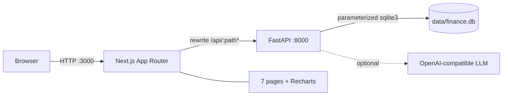

# Enterprise Finance Ontology Agent MVP

> English | [简体中文](README.zh-CN.md)

A minimal end-to-end loop built with a **Next.js + React + TypeScript + Tailwind CSS** frontend, a **FastAPI + stdlib sqlite3** backend, and local **SQLite** mock data. It validates the flow: data sources → metadata → ontology generation → human calibration → Chinese natural-language querying → financial reports → sensitive-data masking.

> This is an MVP for feasibility validation, not a production system. Role switching is for demonstration only and **is not a security boundary**; direct access to `data/finance.db` can bypass API masking.

## 1. Capabilities

| Module | Details |
|--------|---------|
| Data sources | Local SQLite; connection test, one-click seeding/reset, row counts and reconciliation summary |
| Metadata | Tables/columns/types/primary and foreign keys/indexes/samples for 10 business tables; sensitive-column badges and masked samples |
| Ontology | Rule-based generation of 27 terms, 16 relations and 20 SQL attributes; search, edit, certification and change log |
| Ontology service binding | Bind a deployed auto-ontology service from `/ontology`: encrypted token, enable switch, connection test and status card; local rule-based ontology stays unaffected |
| Query | Chinese period/metric/dimension parsing, 14 intent types, parameterized SQL, read-only guard, result masking, query audit |
| Reports | Financial position analysis and profit & loss analysis; KPI/table/chart/text/appendix; reconciliation checks; browser printing |
| Security | Three roles: admin/analyst/viewer; graded masking of phone numbers and bank accounts; audit log |
| Web | 7 pages: dashboard, sources, metadata, ontology, query, reports, security |

## 2. Architecture



- The frontend only calls same-origin `/api/*`; Next.js rewrites these requests to FastAPI (default `http://127.0.0.1:8000`) to avoid CORS.
- Backend read connections use a read-only URI + `PRAGMA query_only` + `set_authorizer`; write connections are only used for seeding, ontology updates and auditing.
- Ontology generation and NL2SQL are rule-driven and work offline; the LLM is an optional enhancement controlled by environment variables and automatically falls back to rules on failure.

## 3. Directory Structure

```text
finance-ontology-mvp/
├── backend/
│   ├── app/
│   │   ├── api/          # 23 HTTP routes
│   │   ├── core/         # config (DB path, LLM, roles)
│   │   ├── db/           # SQLite connections, read-only guard, query helpers
│   │   ├── schemas/      # Pydantic request/response models
│   │   ├── services/     # metadata/ontology/query/reports/security/dashboard
│   │   └── main.py
│   ├── scripts/seed.py   # 16-table DDL + deterministic mock data + reconciliation assertions
│   └── pyproject.toml
├── frontend/
│   ├── app/              # 7 pages (App Router)
│   ├── components/       # AppShell, tables, charts, status components
│   ├── lib/              # api.ts / types.ts / format.ts
│   └── next.config.ts    # /api/* rewrite
├── data/finance.db       # created after seeding (gitignored)
├── package.json          # pnpm dev / build / db:seed
├── pnpm-workspace.yaml
├── .env.example
└── Makefile
```

## 4. Requirements

- macOS / Linux (WSL recommended on Windows)
- Node.js ≥ 20 (verified locally with Node 25.6)
- pnpm 10.x
- Python 3.12+ (verified locally with 3.13.5)
- [uv](https://docs.astral.sh/uv/) 0.5+
- No Docker, Postgres, Redis or Celery required; no internet access needed after the initial dependency install

## 5. Quick Start

```bash
# 1. Install frontend dependencies (the root workspace also installs frontend)
pnpm install

# 2. Install backend dependencies (creates backend/.venv and uv.lock)
cd backend && uv sync
cd ..

# 3. Seed SQLite (16 tables, 22 periods, deterministic seed; repeatable)
pnpm db:seed

# 4. Start backend :8000 and frontend :3000 with one command
pnpm dev

# 5. Build validation (frontend next build + backend compileall)
pnpm build
```

You can also use the Makefile:

```bash
make install   # pnpm install + uv sync
make seed      # pnpm db:seed
make dev       # pnpm dev
make build     # pnpm build
make health    # curl backend health check
make clean     # remove .next/.venv/db
```

Open <http://127.0.0.1:3000>. The default role on first visit is `admin`, which makes seeding and ontology generation easier; role selection is stored in browser localStorage.

### Database Path

The default path is `finance-ontology-mvp/data/finance.db`, resolved by `backend/app/core/config.py` relative to the file location, **independent of the working directory**. Override it with `DATABASE_PATH`:

```bash
DATABASE_PATH=/tmp/finance-demo.db pnpm db:seed
DATABASE_PATH=/tmp/finance-demo.db pnpm dev
```

`scripts/seed.py` and the API share the same resolution logic, so the following two commands are equivalent:

```bash
pnpm db:seed                                  # uv run --directory backend python scripts/seed.py
cd backend && uv run python scripts/seed.py   # also works
```

## 6. 7-Page Smoke Test Path

| Order | Page | Actions and expected results |
|-------|------|-----------------------------|
| 1 | `/` Dashboard | 6 KPIs, 12-period revenue/net profit trends, green reconciliation badge |
| 2 | `/sources` | View SQLite path/table count; connection test succeeds; after re-seeding, row counts and reconciliation results are shown |
| 3 | `/metadata` | Show 10 business tables; open `dim_customer` to view sensitive-column badges and masked samples |
| 4 | `/ontology` | Click Generate (admin) → terms ≥20, relations ≥10, SQL attributes ≥10; edit and certify a term, view the change log |
| 5 | `/query` | Enter a sample question → answer + single SELECT + result table/chart + explanation/lineage; unanswerable questions get suggestions |
| 6 | `/reports` | Generate "Financial Position Analysis" and "Profit & Loss Analysis" → KPI/table/chart/appendix complete, reconciliation passes; click Print |
| 7 | `/security` | View role matrix/masking rules; preview phone/bank_account differences for the same customer across three roles; view audit log |

### Baseline Questions (≥8 answerable)

```text
2026年10月营业收入
2026年10月营业收入同比
2026Q3 毛利率
2026年10月期间费用构成
2026年10月营业利润
2026年10月净利润
2026年10月资产总额和资产负债率
2026年10月 Top 5 客户
2026年10月收入预算达成率
2026年10月应收账款余额
客户明细
近 6 个月收入趋势
```

## 7. Roles and Masking (Demo)

Request header `X-Demo-Role: admin|analyst|viewer`; missing or invalid values fall back to `viewer`. Masking is performed centrally by the backend; the frontend does not process it again.

| Column | admin | analyst | viewer |
|--------|-------|---------|--------|
| `dim_customer.phone` | original | `138****5678` | `***` |
| `dim_customer.bank_account` | original | `**** **** 7890` | `***` |
| `dim_vendor.phone` | original | `177****8765` | `***` |
| `dim_vendor.bank_account` | original | `**** **** 7890` | `***` |

> **Disclaimer**: Role switching is only for demonstrating masking and audit behavior, not a production security boundary. The MVP has no login, SSO, RBAC, row-level isolation, watermarking, or tamper-proof auditing; anyone who can read the SQLite file directly can bypass masking. Production requires proper authentication/authorization, field-level permissions, and audit storage.

## 8. Optional LLM Enhancement

Without LLM configuration, the system works fully offline and querying uses `engine="rule"`. Copy `.env.example` to `.env` and set all three variables to enable it:

```bash
OPENAI_BASE_URL=https://your-openai-compatible-gateway/v1
OPENAI_API_KEY=sk-...
OPENAI_MODEL=your-model
LLM_TIMEOUT_SECONDS=15
```

- The backend calls the OpenAI-compatible `POST {OPENAI_BASE_URL}/chat/completions` endpoint with temperature=0 and expects `{sql, explanation, chart_type}`.
- Prompts contain only the schema summary, term/metric catalog and sample questions; business rows are never sent.
- Generated SQL must pass the read-only guard and table allowlist and is executed with parameters. Any timeout, non-2xx response, parse failure, guard failure or execution error falls back to the rule engine and is explained in `warnings`, with `engine="rule"` in the response.

## 9. Environment Variables

| Variable | Default | Description |
|----------|---------|-------------|
| `BACKEND_URL` | `http://127.0.0.1:8000` | Next rewrite proxy target; server-side only |
| `DATABASE_PATH` | `<repo>/data/finance.db` | SQLite path shared by frontend/backend commands |
| `OPENAI_BASE_URL` | empty | OpenAI-compatible gateway URL |
| `OPENAI_API_KEY` | empty | API key (do not commit) |
| `OPENAI_MODEL` | empty | Model name |
| `LLM_TIMEOUT_SECONDS` | `15` | LLM timeout in seconds |
| `AUTO_ONTOLOGY_ALLOWED_HOSTS` | empty | Optional comma-separated host allowlist for the external ontology service; metadata/link-local addresses are always blocked |
| `AUTO_ONTOLOGY_MAX_TIMEOUT_SECONDS` | `5` | Upper bound for probe timeouts; values above it are rejected rather than truncated |
| `AUTO_ONTOLOGY_MAX_RESPONSE_BYTES` | `65536` | Probe response read cap; exceeding it only sets `truncated=true` |

## 10. FAQ

- **The page says the database does not exist**: run `pnpm db:seed`, or click Re-seed on the `/sources` page.
- **Port already in use**: run `lsof -i :8000` / `lsof -i :3000`, then stop the process; this MVP always uses 3000/8000.
- **`uv sync` fails**: confirm Python ≥3.12 and uv are installed; delete `backend/.venv` and retry.
- **Only one process starts with `pnpm dev`**: concurrently runs with `-k`, so either process exiting stops both; check the terminal logs to locate the backend or frontend error.
- **Query results do not change after editing a term**: querying reads the term's `display_name`/`synonyms` as trigger words; confirm the changes are saved and that the backend is not caching (this MVP re-reads on every request).

## 11. MVP Non-Goals

1. Do not deploy NVIDIA auto-ontology, Postgres/pgvector, NIM, Vault, K8s, Redis or Celery.
2. Do not build CSV/Excel/Hive connectors; the data source is fixed to local SQLite.
3. Do not build formal login/SSO/RBAC/organizational permissions; `X-Demo-Role` is for demonstration only.
4. Do not generate server-side PDF/Word/Excel; use browser printing only.
5. Do not build ontology graph visualization, drag-and-drop modeling, version rollback, or conflict merging.
6. Do not build row-level isolation, watermarking, tamper-proof auditing, or multi-tenancy.
7. Do not build production performance, high availability, backup/recovery, or monitoring/alerting.
8. Do not add automated tests at this stage; tests are added by TASK-04 according to the project's current setup.

## 12. API Documentation

The request/response, error codes, and complete QueryAnswer and ReportDocument structures for the 23 endpoints are documented in `artifacts/finance-ontology-agent-mvp/03-code/api-docs.md`. During development you can also open <http://127.0.0.1:8000/docs> (FastAPI auto-generated docs).

The external auto-ontology binding endpoints (`GET/PUT/DELETE /api/ontology/service`, `POST /api/ontology/service/test`) are documented in `artifacts/auto-ontology-binding/03-code/api-docs.md`. Binding configuration lives in `data/sources.db`; the token is Fernet-encrypted and never returned by any endpoint (only `has_token`). When the binding is unconfigured, disabled or unreachable, local ontology generation and querying behave exactly as before.

## 13. Local Debugging

### 13.1 Starting and Stopping

Run all commands from the **repository root**. Do not run `pnpm dev` inside `frontend/`; that starts only Next.js, and `/api/*` will fail because the backend is not running.

```bash
# Start backend :8000 and frontend :3000 together (concurrently -k; either exit stops both)
pnpm dev

# To inspect logs separately, use two terminals
pnpm dev:backend    # uvicorn app.main:app --host 127.0.0.1 --port 8000 --reload
pnpm dev:frontend   # next dev -p 3000
```

Stop the services with `Ctrl+C` in the terminal that started them. For background processes, find the PID first and then terminate it:

```bash
lsof -nP -iTCP:3000 -sTCP:LISTEN
lsof -nP -iTCP:8000 -sTCP:LISTEN
kill <PID>
```

Health check and minimal connectivity verification:

```bash
curl -s http://127.0.0.1:8000/api/health
curl -s -H 'X-Demo-Role: admin' http://127.0.0.1:8000/api/metrics/summary
curl -s -o /dev/null -w '%{http_code}\n' http://127.0.0.1:3000/metrics
```

On startup, the backend automatically initializes `data/staging.db` and seeds 20 metrics and 10 quality rules; the startup log prints `metric catalog seed` and `quality rule seed`.

### 13.2 Troubleshooting Order

Investigate in this order: backend → frontend → browser network → database.

1. Open `http://127.0.0.1:8000/api/health` to confirm FastAPI is running.
2. Open `http://127.0.0.1:3000/` to confirm Next.js is running.
3. Open browser DevTools → Network and filter by `/api/`: the frontend only calls same-origin `/api/*`, which Next rewrites to `BACKEND_URL` (default `http://127.0.0.1:8000`), so there is no CORS issue. On 502/404, check the backend port and `BACKEND_URL` first.
4. Check the uvicorn access log and exception stack in the startup terminal; backend errors use the unified `{success, data, error}` envelope.
5. Finally, check whether SQLite is seeded and the tables exist.

Interactive FastAPI docs: <http://127.0.0.1:8000/docs>; frontend routes are listed in 13.4.

### 13.3 Database Debugging

This MVP uses three local SQLite files, all under `data/` by default:

| File | Contents |
|------|----------|
| `data/finance.db` | Business DB: 10 dimension/fact tables + ontology/audit tables; seeded by `pnpm db:seed` |
| `data/staging.db` | Ingestion and metrics DB: source ingestion, staging tables, metric definitions/versions/test cases/aliases, quality rules/run results |
| `data/sources.db` | Source registry: connection details, metadata cache, sync records; physically isolated from the business DB |

Common inspection commands:

```bash
sqlite3 data/finance.db '.tables'
sqlite3 data/staging.db '.tables'

# Metric catalog and certification status
sqlite3 -header -column data/staging.db \
  "SELECT code, name, status, current_version FROM metric_definition ORDER BY sort_order LIMIT 10;"

# Metric versions
sqlite3 -header -column data/staging.db \
  "SELECT metric_code, version, status FROM metric_version ORDER BY metric_code, created_at;"

# Quality rules
sqlite3 -header -column data/staging.db \
  "SELECT code, name, rule_type, severity, enabled FROM quality_rule ORDER BY id;"

# Most recent quality run
sqlite3 -header -column data/staging.db \
  "SELECT run_id, trigger_type, status, rules_total, rules_passed, started_at FROM quality_run ORDER BY created_at DESC LIMIT 5;"
```

Reset data:

```bash
# Run after stopping pnpm dev
pnpm db:seed        # resets only the business DB data/finance.db
pnpm clean          # removes .next, backend/.venv and finance.db (keeps staging/sources)
```

To also reset ingestion data and metric drafts, stop the services and **confirm the data is no longer needed**, then delete all three databases and restart:

```bash
rm -f data/finance.db data/finance.db-wal data/finance.db-shm \
      data/staging.db data/sources.db
pnpm db:seed
pnpm dev            # recreates staging/sources and reseeds metrics/quality rules on startup
```

> Deleting `staging.db` loses ingested sources, metric drafts and quality results; deleting `sources.db` loses saved connection details and sync records. Do not run this in production or shared environments.

Custom database path (`staging`/`sources` default to the same directory as `DATABASE_PATH`):

```bash
DATABASE_PATH=/tmp/finance-demo.db pnpm db:seed
DATABASE_PATH=/tmp/finance-demo.db pnpm dev
```

### 13.4 Frontend Page and Role Debugging

Current key pages:

| Page | URL | Debugging notes |
|------|-----|-----------------|
| Metric library | `/metrics?tab=library` | KPIs, filters, full-width metric table; click a row to open details |
| Metric detail | `/metrics?tab=detail&metric=revenue_total&detail=definition` | Sub-tabs: `definition` / `versions` / `tests` / `aliases` |
| Certification workbench | `/metrics?tab=workbench` | Draft/pending queues; shows guidance when empty |
| Governance - quality | `/governance?tab=quality` | Quality rules, runs, results and alerts |
| Reports | `/reports` | Legacy report templates, report packages, Excel export, browser printing |

Role switching is for demonstration only. The backend reads `X-Demo-Role: admin|analyst|viewer`, and the frontend stores the selection in `localStorage` under `demo-role`:

```js
// Browser console
localStorage.setItem('demo-role', 'viewer');
location.reload();
```

To debug permissions/masking, call the API directly with a role header:

```bash
curl -s -H 'X-Demo-Role: viewer' http://127.0.0.1:8000/api/security/policies
curl -s -H 'X-Demo-Role: admin'  http://127.0.0.1:8000/api/metrics/summary
```

Static checks after frontend changes:

```bash
pnpm --dir frontend typecheck
pnpm --dir frontend build     # stop the dev server first to avoid the .next lock
```

### 13.5 Tests

```bash
# Full backend test suite (existing pytest + TestClient setup)
cd backend && .venv/bin/python -m pytest -q

# Or with uv
uv run --directory backend pytest -q
```

The frontend currently has no test framework. Following the existing setup, use `pnpm typecheck`, `pnpm build` and browser smoke tests; do not force in dependencies such as Playwright or Vitest.

### 13.6 Common Issues

| Symptom | What to check |
|---------|---------------|
| Page says the database does not exist | Run `pnpm db:seed`, or re-seed on the `/sources` page |
| `/api/*` returns 502 / keeps spinning | Backend on 8000 is not running, or `BACKEND_URL` is wrong; start services separately and check backend logs |
| `pnpm dev` starts only one process | Make sure you are in the repository root; `concurrently -k` stops both when either exits |
| Port already in use | `lsof -nP -iTCP:3000 -sTCP:LISTEN` / `:8000`, then stop the PID |
| `pnpm build` reports a `.next` lock | Stop `pnpm dev:frontend` first, then build |
| `uv sync` fails | Confirm Python ≥3.12 and uv are installed; delete `backend/.venv` and retry |
| staging/metric APIs return 503 | Check the startup log for `staging initialization failed`, then check `data/` write permissions and `STAGING_DATABASE_PATH` |
| Query results do not change after editing terms/metrics | Make sure changes are saved and certified; querying re-reads on every request and does not cache |
| Metric detail page is blank | Confirm the `metric` parameter exists and the metric is seeded; open `/metrics?tab=library` and select one |

Logs are written to the startup terminal by default; there are no separate log files. Redirect them if you need to keep them:

```bash
pnpm dev > /tmp/finance-dev.log 2>&1
```
