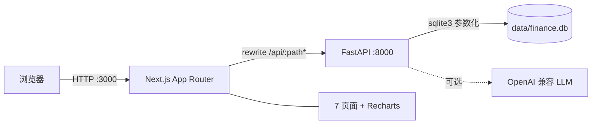

# 企业财务 Ontology Agent MVP

> [English](README.md) | 简体中文

用 **Next.js + React + TypeScript + Tailwind CSS** 前端、**FastAPI + 标准库 sqlite3** 后端和本地 **SQLite** mock 数据，验证「数据源 → 元数据 → 本体生成 → 人工校准 → 中文自然语言问数 → 财务报告 → 敏感脱敏」的最小完整闭环。

> 这是可行性验证用的 MVP，不是生产系统。角色切换仅为演示，**不是安全边界**；直接访问 `data/finance.db` 可绕过 API 掩码。

## 1. 能力范围

| 模块 | 内容 |
|------|------|
| 数据源 | 本地 SQLite，连接测试、一键播种/重置、行数与勾稽摘要 |
| 元数据 | 10 张业务表的表/列/类型/主外键/索引/样本；敏感列徽标与掩码样本 |
| 本体 | 规则生成 27 术语、16 关系、20 SQL 属性；搜索、编辑、认证、变更日志 |
| 问数 | 中文期间/指标/维度解析，14 类意图，参数化 SQL，只读守卫，结果脱敏，查询审计 |
| 报告 | 财务状况分析、损益分析；KPI/表格/图表/文字/附录；勾稽校验；浏览器打印 |
| 安全 | admin/analyst/viewer 三角色，手机号/银行账号分级掩码，审计日志 |
| Web | 7 个页面：仪表盘、数据源、元数据、本体、问数、报告、安全 |

## 2. 架构



- 前端只访问同源 `/api/*`，由 Next.js rewrite 代理到 FastAPI（默认 `http://127.0.0.1:8000`），避免 CORS。
- 后端读连接使用只读 URI + `PRAGMA query_only` + `set_authorizer`；写连接仅用于播种、本体更新与审计。
- 本体生成与 NL2SQL 规则驱动，离线可跑；LLM 仅通过环境变量可选增强，失败自动回退规则。

## 3. 目录结构

```text
finance-ontology-mvp/
├── backend/
│   ├── app/
│   │   ├── api/          # 19 个 HTTP 路由
│   │   ├── core/         # 配置（DB 路径、LLM、角色）
│   │   ├── db/           # SQLite 连接、只读守卫、查询辅助
│   │   ├── schemas/      # Pydantic 请求/响应模型
│   │   ├── services/     # 元数据/本体/问数/报告/安全/仪表盘
│   │   └── main.py
│   ├── scripts/seed.py   # 16 表建表 + 固定种子 mock 数据 + 勾稽断言
│   └── pyproject.toml
├── frontend/
│   ├── app/              # 7 个页面（App Router）
│   ├── components/       # AppShell、表格、图表、状态组件
│   ├── lib/              # api.ts / types.ts / format.ts
│   └── next.config.ts    # /api/* rewrite
├── data/finance.db       # 播种后生成（gitignore）
├── package.json          # pnpm dev / build / db:seed
├── pnpm-workspace.yaml
├── .env.example
└── Makefile
```

## 4. 环境要求

- macOS / Linux（Windows 建议 WSL）
- Node.js ≥ 20（本机验证 Node 25.6）
- pnpm 10.x
- Python 3.12+（本机验证 3.13.5）
- [uv](https://docs.astral.sh/uv/) 0.5+
- 不需要 Docker、Postgres、Redis、Celery；除首次安装依赖外不需要外网

## 5. 快速开始

```bash
# 1. 安装前端依赖（根 workspace 会同时安装 frontend）
pnpm install

# 2. 安装后端依赖（创建 backend/.venv 与 uv.lock）
cd backend && uv sync
cd ..

# 3. 播种 SQLite（16 表、22 期、固定种子，可重复执行）
pnpm db:seed

# 4. 一条命令同时启动后端 :8000 与前端 :3000
pnpm dev

# 5. 构建校验（前端 next build + 后端 compileall）
pnpm build
```

也可以使用 Makefile：

```bash
make install   # pnpm install + uv sync
make seed      # pnpm db:seed
make dev       # pnpm dev
make build     # pnpm build
make health    # curl 后端健康检查
make clean     # 清掉 .next/.venv/db
```

打开 <http://127.0.0.1:3000>。首次进入默认角色 `admin`，便于播种和生成本体；角色切换保存在浏览器 localStorage。

### 数据库路径

默认路径为 `finance-ontology-mvp/data/finance.db`，由 `backend/app/core/config.py` 基于文件位置解析，**与启动目录无关**。可用 `DATABASE_PATH` 覆盖：

```bash
DATABASE_PATH=/tmp/finance-demo.db pnpm db:seed
DATABASE_PATH=/tmp/finance-demo.db pnpm dev
```

`scripts/seed.py` 与 API 使用同一套解析逻辑，因此下面两种方式等价：

```bash
pnpm db:seed                                  # uv run --directory backend python scripts/seed.py
cd backend && uv run python scripts/seed.py   # 同样可用
```

## 6. 7 页冒烟路径

| 顺序 | 页面 | 操作与预期 |
|------|------|-----------|
| 1 | `/` 仪表盘 | 6 个 KPI、12 期收入/净利润趋势、勾稽绿色徽标 |
| 2 | `/sources` | 查看 SQLite 路径/表数；测试连接成功；重新播种后展示行数与勾稽结果 |
| 3 | `/metadata` | 展示 10 张业务表；打开 `dim_customer` 查看敏感列徽标与掩码样本 |
| 4 | `/ontology` | 点击生成（admin）→ 术语 ≥20、关系 ≥10、SQL 属性 ≥10；编辑并认证术语，查看变更日志 |
| 5 | `/query` | 输入示例问题 → 答案 + 单条 SELECT + 结果表/图表 + 解释/溯源；不可回答问题给出建议 |
| 6 | `/reports` | 生成「财务状况分析」「损益分析」→ KPI/表格/图表/附录齐全，勾稽通过；点击打印 |
| 7 | `/security` | 查看角色矩阵/掩码规则；三角色预览同一客户样本的 phone/bank_account 差异；查看审计 |

### 基准问题（≥8 个可回答）

```text
2026年10月营业收入
2026年10月营业收入同比
2026Q3 毛利率
2026年10月期间费用构成
2026年10月营业利润
2026年10月净利润
2026年10月资产总额和资产负债率
2026年10月 Top 5 客户
2026年10月收入预算达成率
2026年10月应收账款余额
客户明细
近 6 个月收入趋势
```

## 7. 角色与脱敏（演示）

请求头 `X-Demo-Role: admin|analyst|viewer`，缺失或非法按 `viewer`。掩码在后端统一完成，前端不做二次处理。

| 列 | admin | analyst | viewer |
|----|-------|---------|--------|
| `dim_customer.phone` | 原值 | `138****5678` | `***` |
| `dim_customer.bank_account` | 原值 | `**** **** 7890` | `***` |
| `dim_vendor.phone` | 原值 | `177****8765` | `***` |
| `dim_vendor.bank_account` | 原值 | `**** **** 7890` | `***` |

> **免责声明**：角色切换仅用于演示脱敏与审计效果，不是生产安全边界。MVP 没有登录、SSO、RBAC、行级隔离、水印或不可篡改审计；任何能直接读取 SQLite 文件的人都可以绕过掩码。生产环境需接入正式认证授权、字段级权限与审计存储。

## 8. 可选 LLM 增强

不配置 LLM 时系统完全离线可用，问数 `engine="rule"`。复制 `.env.example` 为 `.env` 并同时配置以下三个变量后启用：

```bash
OPENAI_BASE_URL=https://your-openai-compatible-gateway/v1
OPENAI_API_KEY=sk-...
OPENAI_MODEL=your-model
LLM_TIMEOUT_SECONDS=15
```

- 后端调用 OpenAI 兼容 `POST {OPENAI_BASE_URL}/chat/completions`，temperature=0，要求返回 `{sql, explanation, chart_type}`。
- 提示词只包含 schema 摘要、术语/指标目录与示例问题，不发送业务行数据。
- 生成的 SQL 必须通过只读守卫与表白名单，参数化执行；任何超时、非 2xx、解析失败、守卫失败或执行错误都会回退规则引擎，并在 `warnings` 中说明，响应 `engine="rule"`。

## 9. 环境变量

| 变量 | 默认 | 说明 |
|------|------|------|
| `BACKEND_URL` | `http://127.0.0.1:8000` | Next rewrite 代理目标，仅服务端使用 |
| `DATABASE_PATH` | `<repo>/data/finance.db` | SQLite 路径，前后端命令共用 |
| `OPENAI_BASE_URL` | 空 | OpenAI 兼容网关地址 |
| `OPENAI_API_KEY` | 空 | API Key（不要提交） |
| `OPENAI_MODEL` | 空 | 模型名 |
| `LLM_TIMEOUT_SECONDS` | `15` | LLM 超时秒数 |

## 10. 常见问题

- **页面提示数据库不存在**：执行 `pnpm db:seed`，或在 `/sources` 页面点击重新播种。
- **端口占用**：`lsof -i :8000` / `lsof -i :3000` 后结束进程；本 MVP 固定 3000/8000。
- **`uv sync` 失败**：确认 Python ≥3.12 与 uv 已安装；删除 `backend/.venv` 后重试。
- **`pnpm dev` 只有一个进程起来**：concurrently 会带 `-k`，任一进程退出会一起退出；查看终端日志定位后端或前端错误。
- **修改术语后问数没变化**：问数会读取术语的 `display_name`/`synonyms` 作为触发词；确认已保存且后端未缓存（本 MVP 每次请求重新读取）。

## 11. MVP 不做清单

1. 不部署 NVIDIA auto-ontology、Postgres/pgvector、NIM、Vault、K8s、Redis、Celery。
2. 不做 CSV/Excel/Hive 连接器，数据源固定为本地 SQLite。
3. 不做正式登录/SSO/RBAC/组织权限，`X-Demo-Role` 仅演示。
4. 不做服务端 PDF/Word/Excel，只用浏览器打印。
5. 不做本体图可视化、拖拽建模、版本回滚、冲突合并。
6. 不做行级隔离、水印、不可篡改审计、多租户。
7. 不做生产性能、高可用、备份恢复、监控告警。
8. 不在本阶段写自动化测试，测试由 TASK-04 按项目现状补充。

## 12. API 文档

19 个端点的请求/响应、错误码、QueryAnswer 与 ReportDocument 完整结构见 `artifacts/finance-ontology-agent-mvp/03-code/api-docs.md`。开发时也可直接访问 <http://127.0.0.1:8000/docs>（FastAPI 自动文档）。

## 13. 本地调试

### 13.1 启动与停止

所有命令都在**仓库根目录**执行。不要在 `frontend/` 下执行 `pnpm dev`，否则只会启动 Next.js，`/api/*` 会因为后端未启动而失败。

```bash
# 同时启动后端 :8000 与前端 :3000（concurrently -k，任一退出会一起退出）
pnpm dev

# 需要分开看日志时，开两个终端
pnpm dev:backend    # uvicorn app.main:app --host 127.0.0.1 --port 8000 --reload
pnpm dev:frontend   # next dev -p 3000
```

停止服务：在启动终端按 `Ctrl+C`。若进程在后台运行，先查 PID 再结束：

```bash
lsof -nP -iTCP:3000 -sTCP:LISTEN
lsof -nP -iTCP:8000 -sTCP:LISTEN
kill <PID>
```

健康检查与最小连通性验证：

```bash
curl -s http://127.0.0.1:8000/api/health
curl -s -H 'X-Demo-Role: admin' http://127.0.0.1:8000/api/metrics/summary
curl -s -o /dev/null -w '%{http_code}\n' http://127.0.0.1:3000/metrics
```

后端启动时会自动初始化 `data/staging.db`、播种 20 个指标与 10 条质量规则；启动日志会打印 `metric catalog seed`、`quality rule seed`。

### 13.2 排查顺序

建议按“后端 → 前端 → 浏览器网络 → 数据库”的顺序定位：

1. 访问 `http://127.0.0.1:8000/api/health`，确认 FastAPI 已启动。
2. 访问 `http://127.0.0.1:3000/`，确认 Next.js 已启动。
3. 打开浏览器 DevTools → Network，过滤 `/api/`：前端只请求同源 `/api/*`，由 Next rewrite 代理到 `BACKEND_URL`（默认 `http://127.0.0.1:8000`），因此不存在 CORS 问题；出现 502/404 时先检查后端端口与 `BACKEND_URL`。
4. 看启动终端里的 uvicorn 访问日志与异常栈；后端异常会返回统一 `{success, data, error}` 信封。
5. 最后查 SQLite 数据是否已播种、表是否存在。

FastAPI 交互式文档：<http://127.0.0.1:8000/docs>；前端页面路由见 13.4。

### 13.3 数据库调试

本 MVP 使用三个本地 SQLite 文件，默认都在 `data/` 下：

| 文件 | 内容 |
|------|------|
| `data/finance.db` | 业务库：10 张维表/事实表 + 本体/审计表，由 `pnpm db:seed` 播种 |
| `data/staging.db` | 接入与指标库：数据源接入、staging 表、指标定义/版本/用例/别名、质量规则/运行结果 |
| `data/sources.db` | 数据源注册库：连接信息、元数据缓存、同步记录；与业务库物理隔离 |

常用检查命令：

```bash
sqlite3 data/finance.db '.tables'
sqlite3 data/staging.db '.tables'

# 指标目录与认证状态
sqlite3 -header -column data/staging.db \
  "SELECT code, name, status, current_version FROM metric_definition ORDER BY sort_order LIMIT 10;"

# 指标版本
sqlite3 -header -column data/staging.db \
  "SELECT metric_code, version, status FROM metric_version ORDER BY metric_code, created_at;"

# 质量规则
sqlite3 -header -column data/staging.db \
  "SELECT code, name, rule_type, severity, enabled FROM quality_rule ORDER BY id;"

# 最近一次质量运行
sqlite3 -header -column data/staging.db \
  "SELECT run_id, trigger_type, status, rules_total, rules_passed, started_at FROM quality_run ORDER BY created_at DESC LIMIT 5;"
```

重置数据：

```bash
# 停止 pnpm dev 后执行
pnpm db:seed        # 只重置业务库 data/finance.db
pnpm clean          # 清理 .next、backend/.venv、finance.db（不删除 staging/sources）
```

若要连同接入数据、指标草稿一起重置，先停止服务并**确认不再需要这些数据**，再删除三库后重启：

```bash
rm -f data/finance.db data/finance.db-wal data/finance.db-shm \
      data/staging.db data/sources.db
pnpm db:seed
pnpm dev            # 启动时重建 staging/sources 并重新播种指标/质量规则
```

> 删除 `staging.db` 会丢失已接入数据源、指标草稿与质量结果；删除 `sources.db` 会丢失已保存的连接信息与同步记录。生产/共享环境不要直接执行。

自定义数据库路径（staging/sources 默认跟随 `DATABASE_PATH` 同目录）：

```bash
DATABASE_PATH=/tmp/finance-demo.db pnpm db:seed
DATABASE_PATH=/tmp/finance-demo.db pnpm dev
```

### 13.4 前端页面与角色调试

当前主要页面：

| 页面 | 地址 | 调试要点 |
|------|------|----------|
| 指标库 | `/metrics?tab=library` | KPI、筛选、全宽指标表、行点击进详情 |
| 指标详情 | `/metrics?tab=detail&metric=revenue_total&detail=definition` | 二级 Tab：`definition` / `versions` / `tests` / `aliases` |
| 认证工作台 | `/metrics?tab=workbench` | draft / pending 队列；空队列时显示引导 |
| 治理-质量 | `/governance?tab=quality` | 质量规则、运行、结果与告警 |
| 报告 | `/reports` | 旧报告模板、报表包、Excel 导出、浏览器打印 |

角色切换只用于演示，后端读取 `X-Demo-Role: admin|analyst|viewer`，前端把选择保存在 `localStorage` 的 `demo-role`：

```js
// 浏览器 Console
localStorage.setItem('demo-role', 'viewer');
location.reload();
```

调试权限/脱敏时也可直接带请求头调用 API：

```bash
curl -s -H 'X-Demo-Role: viewer' http://127.0.0.1:8000/api/security/policies
curl -s -H 'X-Demo-Role: admin'  http://127.0.0.1:8000/api/metrics/summary
```

前端改动后的静态校验：

```bash
pnpm --dir frontend typecheck
pnpm --dir frontend build     # 先停止 dev server，避免 .next 锁冲突
```

### 13.5 测试

```bash
# 后端全量测试（项目现有 pytest + TestClient 体系）
cd backend && .venv/bin/python -m pytest -q

# 或使用 uv
uv run --directory backend pytest -q
```

前端项目当前没有测试框架，按现有体系使用 `pnpm typecheck`、`pnpm build` 和浏览器冒烟，不强行引入 Playwright/Vitest 等依赖。

### 13.6 常见问题速查

| 现象 | 排查 |
|------|------|
| 页面提示数据库不存在 | 执行 `pnpm db:seed`，或在 `/sources` 页面重新播种 |
| `/api/*` 502 / 一直转圈 | 后端 8000 未启动，或 `BACKEND_URL` 配错；分开启动看后端日志 |
| `pnpm dev` 只有一个进程 | 确认在仓库根目录执行；`concurrently -k` 会在任一进程退出时一起退出 |
| 端口占用 | `lsof -nP -iTCP:3000 -sTCP:LISTEN` / `:8000`，结束对应 PID |
| `pnpm build` 报 `.next` 锁 | 先停止 `pnpm dev:frontend`，再构建 |
| `uv sync` 失败 | 确认 Python ≥3.12、uv 已安装；删除 `backend/.venv` 后重试 |
| staging/指标接口 503 | 查看启动日志 `staging initialization failed`，检查 `data/` 写权限与 `STAGING_DATABASE_PATH` |
| 修改术语/指标后问数没变化 | 确认已保存并认证；问数每次请求重新读取，不缓存 |
| 指标详情页空白 | 确认 `metric` 参数存在且指标已播种；访问 `/metrics?tab=library` 重新选择 |

日志默认输出到启动终端，没有额外日志文件；需要留存时重定向即可：

```bash
pnpm dev > /tmp/finance-dev.log 2>&1
```

